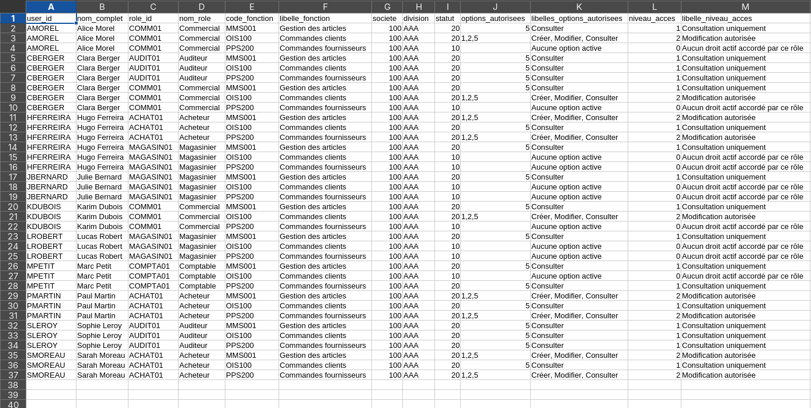

# Sonepar Libellés

Projet pédagogique réalisé de manière autonome à la suite d’un échange dans le cadre de ma candidature à une alternance chez Sonepar. Il s’inspire des enjeux de gestion des habilitations autour de l’ERP Infor M3.

L’application Django a été développée dans le but de mieux comprendre le travail de l’équipe sur la gestion des habilitations M3, notamment le traitement des droits des fonctions, stockés en base de données sous forme de valeurs `0`, `1` ou `2`, leur association aux libellés correspondants et leur export au format CSV. Faute d’accès à un environnement Infor M3, les données sources sont simulées à l’aide de fichiers CSV placés dans le dossier `donnees/`.

> **Important — hypothèse de classification :** n’ayant pas trouvé d’informations précises sur la signification des valeurs `0`, `1` et `2` pour les droits de fonctions M3, cette classification repose sur une hypothèse retenue pour le projet. Elle ne constitue pas une nomenclature standard confirmée par la documentation Infor M3.

## Aperçu de l’export CSV



## Contexte métier

Le cas d’usage s’inspire d’une équipe chargée de la gestion des habilitations et des audits M3 : autoriser ou non certains profils à accéder aux fonctions de l’ERP, puis exploiter ces données dans des rapports ou des exports.

Ce dépôt se concentre sur le volet **Django / Python** de cette exploration. Il ne constitue pas une application interne de Sonepar et ne se connecte à aucun environnement M3.

## Finalité métier

Dans le cadre de ce projet, les niveaux d’accès aux fonctions M3 sont représentés par des valeurs numériques (`0`, `1` ou `2`). L’application associe ces valeurs à leurs libellés correspondants afin de faciliter leur lecture et leur interprétation.

Elle permet notamment de préparer des données enrichies pour des exports CSV, contenant à la fois le niveau d’accès et son libellé métier.

## Données simulées

Les fichiers CSV du dossier `donnees/` constituent un jeu de données fictif destiné à initialiser la base de données de l’application Django.

Ils sont organisés en deux ensembles : les données simulant les informations récupérables depuis M3 et les référentiels de correspondance utilisés pour leur associer des libellés.

### Données simulant les API M3

Quatre fichiers simulent les réponses de transactions API d’Infor M3 :

| Fichier CSV | API / Transaction | Contenu |
| --- | --- | --- |
| `MNS150MI_LstUsers.csv` | MNS150MI / LstUsers | Utilisateurs M3 |
| `MNS405MI_Lst.csv` | MNS405MI / Lst | Rôles disponibles |
| `MNS410MI_LstRolesByUser.csv` | MNS410MI / LstRolesByUser | Rôles attribués aux utilisateurs |
| `SES400MI_LstAuthByRole.csv` | SES400MI / LstAuthByRole | Autorisations par rôle et fonction |

Ces fichiers permettent de représenter les relations entre les utilisateurs, leurs rôles et les autorisations associées aux fonctions M3.

Les structures et les données ont été simplifiées pour les besoins du projet. Elles ne constituent pas des réponses authentiques des API M3.

### Référentiels de libellés

Trois fichiers complémentaires définissent les correspondances utilisées par l’application :

| Fichier CSV | Contenu |
| --- | --- |
| `libelles_fonctions.csv` | Codes des fonctions M3 et libellés correspondants |
| `libelles_niveaux_acces.csv` | Niveaux d’accès numériques et libellés associés |
| `libelles_options.csv` | Codes des options autorisées et libellés correspondants |

Pour les besoins du projet, les niveaux d’accès sont interprétés selon la correspondance suivante :

| Niveau | Libellé |
| --- | --- |
| `0` | Aucun droit actif accordé par ce rôle |
| `1` | Consultation uniquement |
| `2` | Modification autorisée |

### Exploitation des données

Une fois les fichiers importés en base de données, l’application peut rapprocher les utilisateurs, leurs rôles et les autorisations associées aux fonctions M3.

Les référentiels permettent ensuite d’enrichir ces informations avec les libellés des fonctions, des niveaux d’accès et des options autorisées, afin de produire des exports CSV compréhensibles et exploitables dans le cadre des audits.

## Prérequis

- Python 3.12 ou supérieur ;
- `pip` ;
- Git (pour cloner le dépôt).

Le projet utilise SQLite en développement : aucune base de données externe n'est nécessaire. La base est créée dans `database/db.sqlite3` lors de l'application des migrations.

## Structure du projet

```text
app/        Application Django et commandes de gestion
config/     Configuration Django
database/   Base SQLite locale
donnees/    Fichiers CSV simulant les données M3
manage.py   Point d'entrée Django
```

## Installation

Depuis la racine du dépôt :

```bash
python3 -m venv .venv
source .venv/bin/activate
python -m pip install --upgrade pip
python -m pip install -r requirements.txt
```

Sous Windows (PowerShell), l'activation de l'environnement virtuel s'effectue avec :

```powershell
.\.venv\Scripts\Activate.ps1
```

## Initialiser les données

Appliquer les migrations, charger les référentiels CSV, puis générer un audit :

```bash
python manage.py migrate
python manage.py seed_all
python manage.py audit_habilitations
python manage.py export_audit_habilitations
```

La commande `seed_all` charge les référentiels de fonctions, niveaux d'accès, options, utilisateurs, rôles et associations M3. Chaque seeder ne charge des données que si sa table est vide.

La commande `audit_habilitations` rapproche les utilisateurs, rôles, autorisations et référentiels. Elle crée un audit horodaté et conserve ses habilitations dans la base. Chaque lancement crée un nouvel historique.

La commande `export_audit_habilitations` exporte le dernier audit des habilitations dans un fichier `exports/audit_habilitations_<id>_<datetime>.csv`, afin de le consulter ou de le transmettre.

## Conclusion

Ce projet m’a permis de me familiariser avec une infime partie des enjeux de gestion des habilitations autour de l’ERP Infor M3, tout en mettant en pratique mes compétences en Django et Python.
