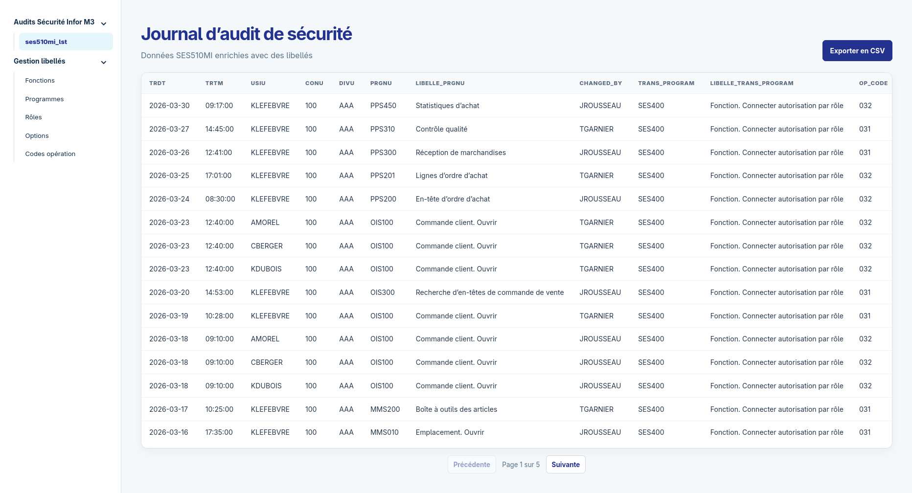
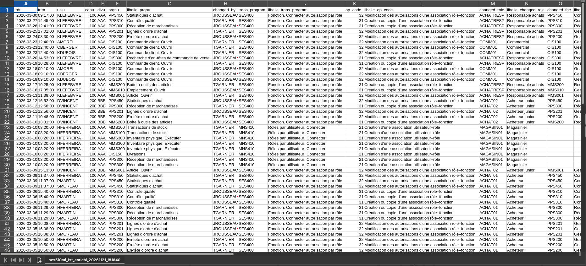

# Sonepar Libellés

Projet pédagogique réalisé de manière autonome à la suite d’un échange dans le cadre de ma candidature à une alternance chez Sonepar. Il s’inspire des enjeux de gestion des habilitations autour de l’ERP Infor M3.

L’application Django permet de consulter l’historique des modifications de sécurité M3 et d’enrichir ses codes avec des libellés. Faute d’accès à un environnement Infor M3, les données sources sont simulées à l’aide de fichiers CSV placés dans le dossier `data/`.

Ce projet m’a permis de me familiariser avec une infime partie des enjeux de gestion des habilitations autour de l’ERP Infor M3, tout en mettant en pratique mes compétences en Django et Python.

## Aperçu de l’application



## Export CSV

Les résultats de l’audit peuvent être exportés au format CSV.



## Contexte métier

Le cas d’usage s’inspire d’une équipe chargée de la gestion des habilitations M3 suivant les modifications de sécurité.

Ce dépôt réunit une API **Django / Django REST Framework** et un frontend **Angular standalone**. Il ne constitue pas une application interne de Sonepar et ne se connecte à aucun environnement M3.

## Données simulées

Les fichiers CSV du dossier `data/` constituent un jeu de données fictif destiné à initialiser la base de données de l’application Django.

Un fichier simule une extraction M3 :

| Fichier CSV | API / Transaction | Contenu |
| --- | --- | --- |
| `SES510MI.csv` | SES510MI / Lst | Journal d’audit de sécurité et droits modifiés |

Quatre référentiels locaux complètent ces données :

| Fichier CSV | Contenu |
| --- | --- |
| `libelles_fonctions.csv` | Libellés des fonctions M3 présentes dans SES510 |
| `libelles_programmes.csv` | Libellés des programmes M3 présents dans SES510 |
| `libelles_roles.csv` | Libellés simulés des rôles présents dans SES510 |
| `libelles_options.csv` | Libellés des options présentes dans SES510 |
| `libelles_op_codes.csv` | Libellés des codes opération de l’audit SES510 |

Les structures et les données ont été simplifiées pour les besoins du projet. Elles ne constituent pas des réponses authentiques des API M3.

## Prérequis

- Python 3.12 ou supérieur ;
- `pip` ;
- Node.js et npm (pour le frontend Angular) ;
- Git (pour cloner le dépôt).

Le projet utilise SQLite en développement : aucune base de données externe n'est nécessaire. La base est créée dans `apps/api/labels/database/db.sqlite3` lors de l'application des migrations.

## Installation

Depuis la racine du dépôt :

```bash
python3 -m venv .venv
source .venv/bin/activate
python -m pip install --upgrade pip
python -m pip install -r apps/api/requirements.txt

cd apps/web
npm install
cd ..
```

Sous Windows (PowerShell), l'activation de l'environnement virtuel s'effectue avec :

```powershell
.\.venv\Scripts\Activate.ps1
```

## Initialisation au premier lancement

Cette version reconstruit le schéma pour correspondre aux sources CSV actuelles. Supprimez toute base créée avec une version antérieure avant de continuer :

```bash
rm -f apps/api/labels/database/db.sqlite3
```

Activez ensuite l’environnement virtuel, appliquez les migrations, puis chargez les données CSV simulées :

```bash
source .venv/bin/activate
python apps/api/manage.py migrate
python apps/api/manage.py seed_all
```

La commande `seed_all` synchronise l’audit SES510 et les quatre référentiels de libellés. Après l’import SES510, les codes distincts sont ajoutés aux catalogues de libellés sans écraser les valeurs existantes. Les CSV de référentiel sont ensuite synchronisés et remplacent les libellés modifiés dans l’interface. Les listes de libellés sont paginées côté API.

## Lancer l’application

Après l’initialisation, démarrez les deux serveurs dans deux terminaux distincts.

### API Python (Django)

Dans le terminal où l’environnement virtuel est activé, à la racine du dépôt :

```bash
python apps/api/manage.py runserver
```

Si vous ouvrez un nouveau terminal, réactivez d’abord l’environnement avec `source .venv/bin/activate`. L’API est disponible sur <http://127.0.0.1:8000> et son état peut être vérifié sur <http://127.0.0.1:8000/api/health/>.

### Frontend Angular

Dans un second terminal :

```bash
cd apps/web
npm start
```

Ouvrez ensuite <http://localhost:4200>. Le serveur Angular utilise `apps/web/proxy.conf.json` pour transmettre automatiquement les requêtes `/api/` à Django sur le port `8000` : les deux serveurs doivent donc rester lancés pendant le développement.
