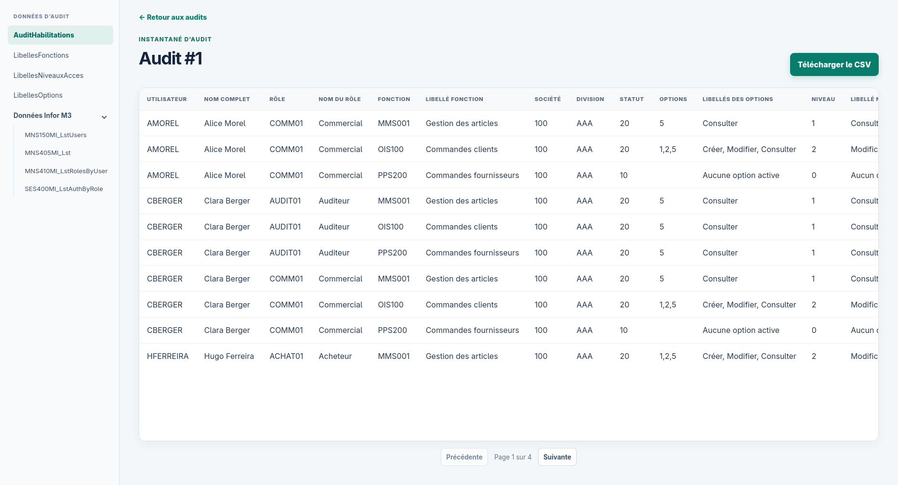

# Sonepar Libellés

Projet pédagogique réalisé de manière autonome à la suite d’un échange dans le cadre de ma candidature à une alternance chez Sonepar. Il s’inspire des enjeux de gestion des habilitations autour de l’ERP Infor M3.

L’application Django permet de consulter les données de sécurité M3 : catalogue de fonctions, utilisateurs, rôles, droits théoriques, droits effectifs et historique des modifications. Faute d’accès à un environnement Infor M3, les données sources sont simulées à l’aide de fichiers CSV placés dans le dossier `donnees/`.

## Aperçu de l’application



## Contexte métier

Le cas d’usage s’inspire d’une équipe chargée de la gestion des habilitations M3 : administrer les rôles et les droits associés, consulter les droits effectifs des utilisateurs et suivre les modifications de sécurité.

Ce dépôt réunit une API **Django / Django REST Framework** et un frontend **Angular standalone**. Il ne constitue pas une application interne de Sonepar et ne se connecte à aucun environnement M3.

## Données simulées

Les fichiers CSV du dossier `donnees/` constituent un jeu de données fictif destiné à initialiser la base de données de l’application Django.

Ils sont organisés en deux ensembles : les données simulant les informations récupérables depuis M3 et les référentiels de libellés.

### Données simulant les API M3

Sept fichiers simulent les réponses de transactions ou extractions M3 :

| Fichier CSV | API / Transaction | Contenu |
| --- | --- | --- |
| `MNS110MI_Lst.csv` | MNS110MI / Lst | Catalogue des fonctions et programmes M3 |
| `MNS150MI_LstUsers.csv` | MNS150MI / LstUsers | Utilisateurs M3 |
| `MNS405MI_Lst.csv` | MNS405MI / Lst | Rôles disponibles |
| `MNS410MI_LstRolesByUser.csv` | MNS410MI / LstRolesByUser | Rôles attribués aux utilisateurs |
| `SES400MI_LstAuthByRole.csv` | SES400MI / LstAuthByRole | Autorisations par rôle et fonction |
| `SES401_CMNPUS.csv` | SES401 / CMNPUS | Droits effectifs par utilisateur et programme |
| `SES510MI_Lst.csv` | SES510MI / Lst | Historique des modifications d’habilitations |

Les fichiers SES400 et SES401 sont structurés avec une ligne par code option. SES401 identifie également le rôle source de chaque droit. Un code option vide est conservé tel quel lorsqu’il est présent dans la source. Le journal SES510 conserve également une ligne par couple événement-option, avec les valeurs brutes `Oui` / `Non` avant et après la modification.

Ces fichiers permettent de consulter les relations entre les utilisateurs, leurs rôles, leurs autorisations et les modifications apportées aux droits.

Les structures et les données ont été simplifiées pour les besoins du projet. Elles ne constituent pas des réponses authentiques des API M3.

### Référentiels de libellés

Deux fichiers complémentaires définissent les correspondances utilisées par l’application :

| Fichier CSV | Contenu |
| --- | --- |
| `libelles_fonctions.csv` | Codes des fonctions M3 et libellés correspondants |
| `libelles_options.csv` | Codes des options autorisées et libellés correspondants |

### Exploitation des données

Une fois les fichiers importés en base de données, l’API et l’interface Angular exposent chaque source sous forme de tableau de consultation. Les référentiels apportent les libellés de fonctions et d’options complémentaires.

## Prérequis

- Python 3.12 ou supérieur ;
- `pip` ;
- Node.js et npm (pour le frontend Angular) ;
- Git (pour cloner le dépôt).

Le projet utilise SQLite en développement : aucune base de données externe n'est nécessaire. La base est créée dans `database/db.sqlite3` lors de l'application des migrations.

## Structure du projet

```text
app/        Application Django et commandes de gestion
config/     Configuration Django
database/   Base SQLite locale
donnees/    Fichiers CSV simulant les données M3
frontend/   Application Angular standalone
manage.py   Point d'entrée Django
```

## Installation

Depuis la racine du dépôt :

```bash
python3 -m venv .venv
source .venv/bin/activate
python -m pip install --upgrade pip
python -m pip install -r requirements.txt

cd frontend
npm install
cd ..
```

Sous Windows (PowerShell), l'activation de l'environnement virtuel s'effectue avec :

```powershell
.\.venv\Scripts\Activate.ps1
```

## Initialisation au premier lancement

Cette version reconstruit l’historique des migrations pour correspondre aux sources CSV actuelles. Si vous disposez d’une base créée avec une version antérieure, supprimez `database/db.sqlite3` avant de continuer.

Activez ensuite l’environnement virtuel, appliquez les migrations, puis chargez les données CSV simulées :

```bash
source .venv/bin/activate
python manage.py migrate
python manage.py seed_all
```

La commande `seed_all` synchronise les neuf sources CSV. Elle peut être relancée : les lignes existantes sont mises à jour à partir de leur clé métier, sans créer de doublons.

## Lancer l’application

Après l’initialisation, démarrez les deux serveurs dans deux terminaux distincts.

### API Python (Django)

Dans le terminal où l’environnement virtuel est activé, à la racine du dépôt :

```bash
python manage.py runserver
```

Si vous ouvrez un nouveau terminal, réactivez d’abord l’environnement avec `source .venv/bin/activate`. L’API est disponible sur <http://127.0.0.1:8000> et son état peut être vérifié sur <http://127.0.0.1:8000/api/health/>.

### Frontend Angular

Dans un second terminal :

```bash
cd frontend
npm start
```

Ouvrez ensuite <http://localhost:4200>. Le serveur Angular utilise `frontend/proxy.conf.json` pour transmettre automatiquement les requêtes `/api/` à Django sur le port `8000` : les deux serveurs doivent donc rester lancés pendant le développement.

## Conclusion

Ce projet m’a permis de me familiariser avec une infime partie des enjeux de gestion des habilitations autour de l’ERP Infor M3, tout en mettant en pratique mes compétences en Django et Python.
